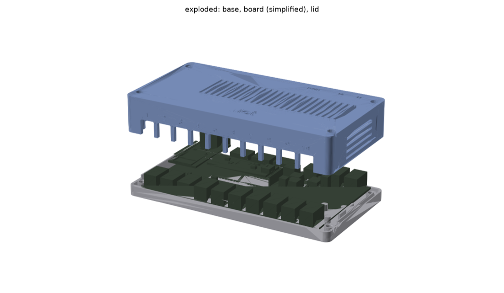
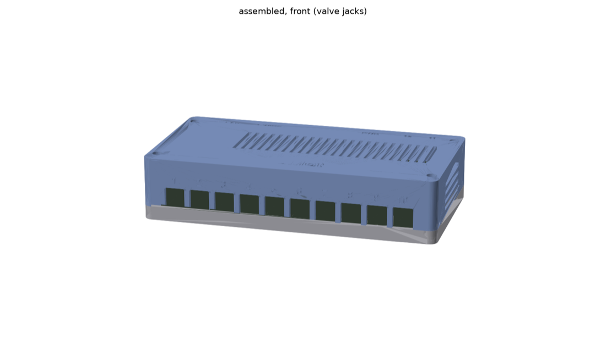
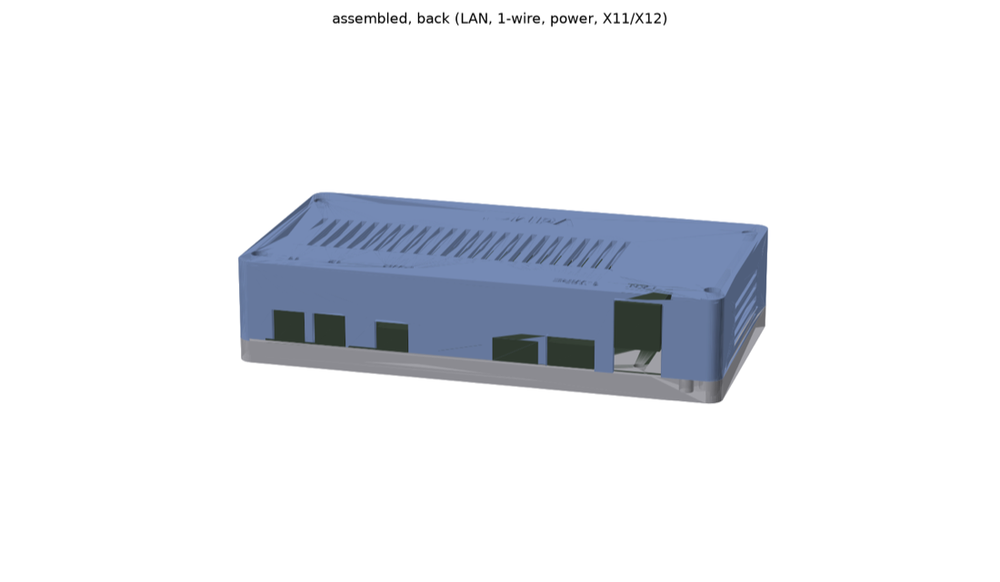
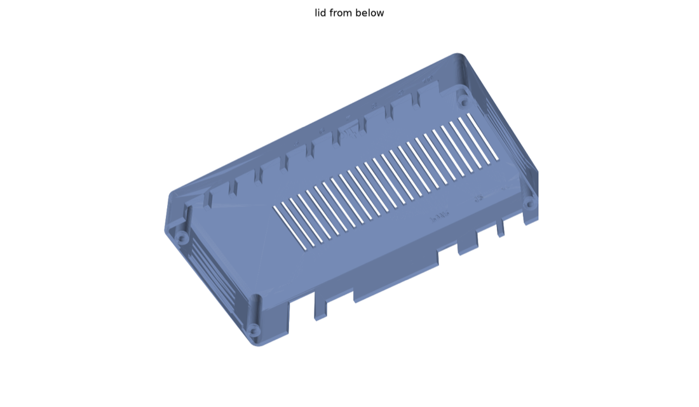
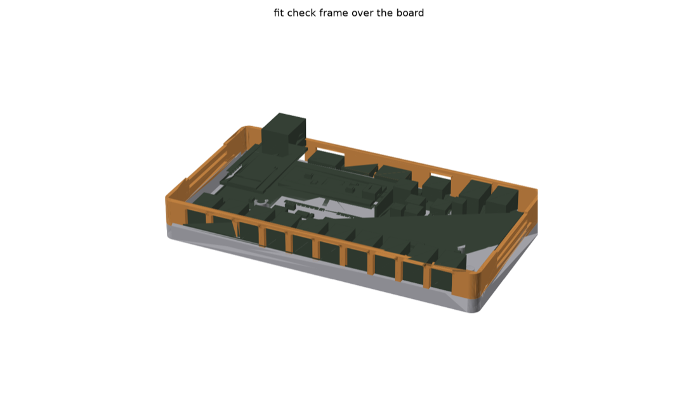

# 3D printable case (draft)

A two part case for the VdMot Controller board: a base tray the board sits in and a lid that
slides down over the connectors. Generated by a parametric FreeCAD script from the board 3D model
[`../c3-sample_3D.rar`](../c3-sample_3D.rar) (C3 revision).

**Status: draft, not printed yet.** The geometry was checked against the 3D model of the board
(no collisions, the board only touches the posts and clamps), but not against a real board.
Print the fit check frame first.



| front (valve jacks 1-10) | back (LAN, 1-wire, power, 11, 12) |
|---|---|
|  |  |

## Files

| file | |
|---|---|
| `vdmot_case_base.stl` | base tray |
| `vdmot_case_lid.stl` | lid |
| `vdmot_case_fitcheck.stl` | lower 14 mm of the lid walls with all openings, to check the fit on the soldered board |
| `vdmot_case.step` | base and lid as STEP for other CAD programs |
| `vdmot_case.py` | FreeCAD script that generates all of the above |

Outer size 175.4 x 92.0 x 37.6 mm with rounded corners, it fits on a 180 x 180 mm bed
(Bambu Lab A1 mini) with about 2 mm to spare on each side. The front wall is 3 mm thick and the
valve jack openings have rounded top corners, so the fingers between them do not break easily;
side walls 2 mm, back wall 2.2 mm (the terminal plugs have to reach their headers).

## How it works

- The board is screwed to the base through two of its mounting holes (between the power
  terminal and X12, and below the WT32 module), M3 x 6 into heat set inserts. It also rests on
  9 support posts at spots without through hole pins below (at least 1.9 mm to the next pin or
  part, measured on the bounding boxes of the 3D model).
- The hole positions were measured on a real board, they are not in the 3D model
  (`BOARD_SCREWS` in the script).
- The connectors along the front and back edge sit just below their openings in the lid
  (0.5 mm), so the lid has no pins pressing on the board.
- Below the board there are 5 mm to the floor. The longest pins of the 3D model (valve jacks)
  stick out 1.9 mm, so trim all leads you solder to 3 mm or less.
- Small stops at the left and right board edges keep it from sliding sideways, the openings
  of the lid lock it once the lid is on.
- All openings are open at the bottom edge of the lid, so it slides down over the connectors and
  prints without supports.
- The lid is screwed to the base with 4 x M3 from the top. The base can be screwed to a wall or
  the back of the manifold cabinet with 4 screws through the floor, reachable with the lid off.
- The inner part of the base side walls rises as a lip into a rebate of the lid, to align both.
- Vents in the top and the side walls, engraved numbers above the valve jacks and labels for the
  connectors on the back.



## Printing

- PLA is fine for low temperature floor heating (supply up to about 40 °C), as long as the case
  does not sit on the supply pipes or next to the boiler. PLA softens at 55-60 °C, PETG or ASA
  for warmer places.
- PETG on a large flat part tends to lift at the corners: clean the plate with dish soap,
  70-80 °C bed, no part cooling for the first layers, glue stick on textured PEI.
- Base: floor down. Lid and fit check frame: upside down (top on the bed). No supports needed.
- 0.2 mm layers, 3-4 walls, 15-20 % infill.

## Hardware

- 4 x M3 x 8 socket head screws (DIN 912) for the lid.
- 2 x M3 x 6 socket head screws for the board.
- 6 x heat set inserts M3, 4 mm long (e.g. ruthex M3 short, RX-M3Sx4.0): 4 for the lid screws,
  2 for the board screws.
  The holes are 4.0 mm with a small chamfer and 7.1 mm deep. Press the inserts in with a
  soldering iron until they are flush with or slightly below the top of the post, an insert
  that sticks out keeps the lid from closing flat.
  Without inserts: set `SCREW_PILOT_D = 2.6` and `INSERT_CHAMFER = 0` and use self tapping screws.
- 4 x screws up to 3.5 mm with a head of at most 7 mm for the wall mounting (holes 4.0 mm).

## Assembly

1. Print the fit check frame and put it over the soldered board: every connector has to sit
   in its opening. If something is off, adjust `CONNECTORS` in the script and regenerate.
   This matters because the case was made from the C3 model and the C4 revision moved the
   valve jacks closer to the board edge.
2. Screw the base to the wall.
3. Pull the WT32-ETH01 module off its headers, put the board into the base (valve jacks to the
   front, the side with the numbers) and screw it down with the two M3 x 6. The second screw
   sits below the module. Plug the module back in.
4. Put the lid on and screw it to the base.



## Changing it

Open `vdmot_case.py` in FreeCAD (Macro > Macros..., or just run it) or run it on the command line,
the STL and STEP files are written next to the script:

```sh
/Applications/FreeCAD.app/Contents/Resources/bin/freecadcmd -c "exec(open('vdmot_case.py').read())"
```

All sizes are parameters at the top of the script, for example:

- `CONNECTORS`: openings and labels. The openings for X17 (RS485) and X19 (CAN) are closed,
  set them to `True` if these terminals are fitted.
- `PLUG_OPENING_TOP`: height of the openings for the pluggable terminals (X13 power, X18 1-wire).
  The screw plugs stay outside the case, but their latches reach into it just above the header,
  so these openings are 2 mm higher than the header needs (10.9 mm above the board).
- `CLAMPS`, `CLAMP_GAP`: positions of the pins of the lid and their gap above the board
  (0.75 mm). 0 or a small negative value (e.g. -0.2) clamps the board.
- `INNER_H`, `SIDE_MARGIN`, `WALL`, `STANDOFF`, `CORNER_R`: size and corners of the case.
- `SCREW_PILOT_D`, `MOUNT_Y`, `SCREW_Y`: screws.
- `FONT`, `TITLE`, `LABEL_H`: labels (the default font path is for macOS).

Not included yet: a DIN rail clip and strain relief for the cables.
